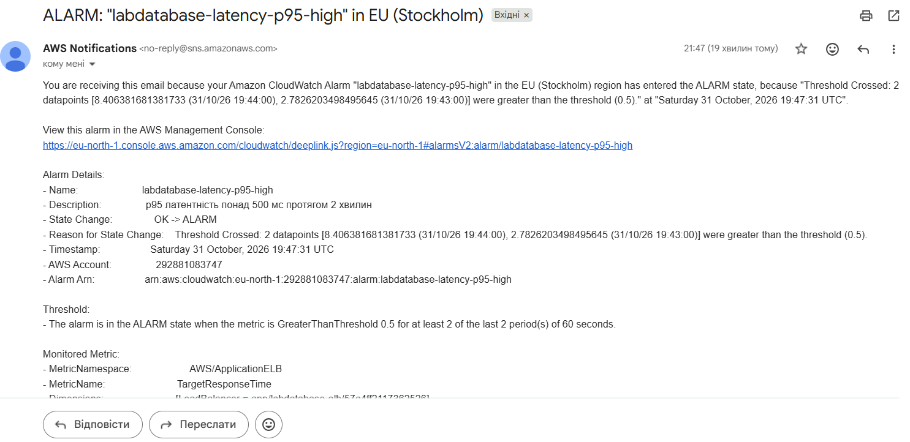

# Сповіщення

## Умова сповіщення

Сповіщення спрацьовує, коли латентність p95 застосунку перевищує 500 мс протягом 2 хвилин.

| Параметр | Значення |
|---|---|
| Метрика | `TargetResponseTime` (простір `AWS/ApplicationELB`) |
| Статистика | p95 |
| Поріг | 0,5 с |
| Період | 60 с |
| Кількість періодів | 2 з 2 |
| Канал доставки | SNS-топік `labdatabase-alerts`, підписка email |

Обґрунтування: латентність p95 показує, як швидко відповідає сервіс для майже всіх користувачів, тобто краще відображає досвід користувача, ніж середнє значення. Поріг 500 мс взято як орієнтир для API. Умова «2 з 2 періодів» потрібна, щоб не реагувати на одиночний сплеск.

Аларм описаний у `terraform/alerts.tf` (ресурс `aws_cloudwatch_metric_alarm.latency_p95`).

## Результати: прогін 8 листопада 2026

Сценарій із [LOADTEST.md](LOADTEST.md): наростання 3 хв до 30 користувачів, стале навантаження 5 хв, спад 2 хв. Час — київський (UTC+2). Дані взято з історії аларму в CloudWatch.

| Подія | Час |
|---|---|
| Початок навантаження | 13:20:06 |
| Перевищення порогу: p95 = 1,9 с | хвилина 13:20 |
| Перевищення порогу: p95 = 4,1 с | хвилина 13:21 |
| Початок сталого навантаження (30 користувачів) | 13:23:01 |
| Перехід у стан `ALARM`, лист ALARM | 13:24:45 |
| Кінець навантаження | 13:30:06 |
| Остання точка нижче порогу: p95 = 0,47 с | хвилина 13:30 |
| Перехід у стан `OK`, лист OK | 13:33:45 |

Обидва листи у скриньці:

### Час реакції

- **Від початку сталого навантаження до листа ALARM — 1 хв 44 с** (13:23:01 → 13:24:45).
- **Від першого перевищення порогу — близько 4 хв 45 с.** Латентність перевищила 0,5 с уже на першій хвилині наростання (13:20), тобто ще до сталого навантаження.
- **Від кінця навантаження до листа OK — 3 хв 39 с.**

Затримка складається з таких частин:

- аларм вимагає два періоди поспіль по 60 с, тому реагує лише на стійке перевищення;
- метрики балансувальника надходять у CloudWatch із затримкою 1–3 хвилини: точки за 13:20 і 13:21 були оцінені лише о 13:24:45;
- доставка листа через SNS і email займає кілька секунд.

## Попередній прогін: 31 жовтня 2026

Тест зі старою версією сценарію (наростання 2,5 хв). Час — київський (UTC+2).

| Подія | Час |
|---|---|
| Початок наростання | 21:43:21 |
| Перевищення порогу: p95 = 2,8 с | хвилина 21:43 |
| Перевищення порогу: p95 = 8,4 с | хвилина 21:44 |
| Початок сталого навантаження | 21:45:51 |
| Лист ALARM | 21:47:31 |
| Лист OK | 22:00:31 |

Від початку сталого навантаження до листа ALARM минуло 1 хв 40 с, тобто майже стільки ж, скільки 8 листопада.

Повний текст листів:

## Оцінка

Для внутрішнього сервісу така реакція прийнятна: команда дізнається про проблему протягом кількох хвилин і може перевірити панель. Для критичного сервісу (наприклад, платежів) цього замало, бо користувачі встигають відчути збій, а лист приходить лише людині. Там потрібні коротші періоди вимірювання, автоматичні дії (наприклад, додавання ресурсів) і канали з миттєвою доставкою.