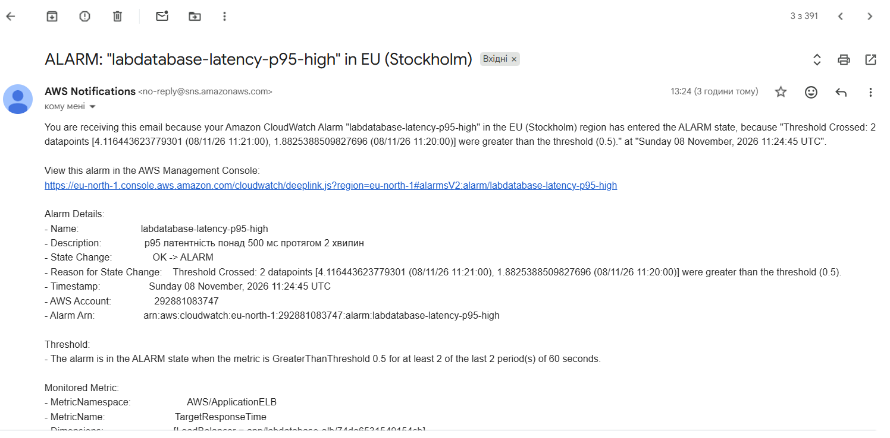
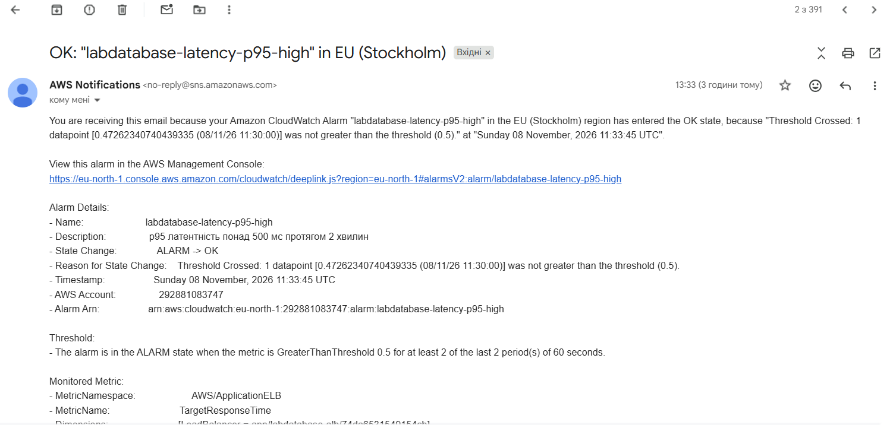

# Сповіщення

## Умова

Сповіщення спрацьовує, коли латентність p95 перевищує 500 мс протягом 2 хвилин. Описано в `terraform/alerts.tf`.

| Параметр | Значення |
|---|---|
| Метрика | `TargetResponseTime` (`AWS/ApplicationELB`), статистика p95 |
| Поріг | 0,5 с |
| Період | 60 с, 2 періоди поспіль |
| Канал | SNS-топік `labdatabase-alerts`, підписка email |

Латентність p95 показує, як швидко сервіс відповідає майже всім користувачам, тому краще відображає проблему, ніж CPU чи середнє значення. Умова «2 періоди поспіль» потрібна, щоб не реагувати на одиночний сплеск.

## Листи

Тест 8 листопада 2026, час київський.

| Подія | Час |
|---|---|
| Початок навантаження | 13:20:06 |
| Початок сталого навантаження | 13:23:01 |
| Лист ALARM | 13:24:45 |
| Кінець навантаження | 13:30:06 |
| Лист OK | 13:33:45 |

## Час реакції

Від початку сталого навантаження до листа ALARM минуло **1 хв 44 с**.

Затримка складається з:
- двох періодів по 60 с, які потрібні для спрацювання;
- затримки надходження метрик балансувальника в CloudWatch (1–3 хв);
- доставки листа через SNS (кілька секунд).

## Оцінка

Для навчального або внутрішнього сервісу такий час реакції прийнятний. Для критичного сервісу він завеликий: користувачі встигають відчути проблему раніше, ніж приходить лист. Там потрібні коротші періоди, автоматичні дії і швидші канали сповіщення.

! 