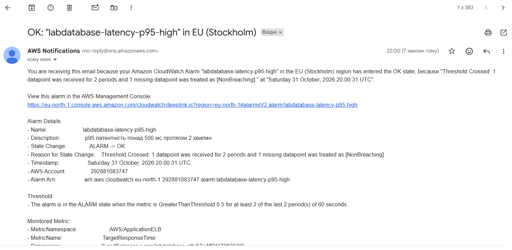

# Сповіщення

## Умова сповіщення

Сповіщення спрацьовує, коли латентність p95 застосунку перевищує 500 мс протягом 2 хвилин.

| Параметр | Значення |
|---|---|
| Метрика | `TargetResponseTime` (простір `AWS/ApplicationELB`) |
| Статистика | p95 |
| Поріг | 0,5 с |
| Період | 60 с |
| Кількість періодів | 2 з 2 |
| Канал доставки | SNS-топік `labdatabase-alerts`, підписка email |

Обґрунтування: латентність p95 показує, як швидко відповідає сервіс для майже всіх користувачів, тобто краще відображає досвід користувача, ніж середнє значення. Поріг 500 мс взято як орієнтир для API. Умова «2 з 2 періодів» потрібна, щоб не реагувати на одиночний сплеск.

Аларм описаний у `terraform/alerts.tf` (ресурс `aws_cloudwatch_metric_alarm.latency_p95`).

## Результати тесту

Тест проходив у три фази: наростання 2,5 хв до 30 користувачів, стале навантаження 5 хв, спад 2 хв.

| Подія | Час (UTC) |
|---|---|
| Початок наростання | 19:43:21 |
| Початок сталого навантаження (30 користувачів) | 19:45:51 |
| Перевищення порогу: p95 = 2,8 с | хвилина 19:43 |
| Перевищення порогу: p95 = 8,4 с | хвилина 19:44 |
| Лист `ALARM` | 19:47:31 |
| Лист `OK` | 22:00 |

Перевищення почалося ще під час наростання, тому аларм спрацював уже після того, як навантаження досягло 30 користувачів і проблема тривала.

| Показник | Значення |
|---|---|
| Усього запитів | 1557 |
| Помилок | 0 (0%) |
| Пропускна здатність | ~3,1 запиту/с |
| Латентність p50 | 6,7 с |
| Латентність p95 | 14 с |
| Латентність p99 | 15 с |

Результати збережено у файлах `docs/loadtest_run3_stats.csv` та `docs/loadtest_run3_stats_history.csv`.

Скріншоти:

## Час реакції

Від початку сталого навантаження (19:45:51) до листа `ALARM` (19:47:31) минуло **1 хвилина 40 секунд**. Від початку наростання минуло 4 хвилини 10 секунд.

Затримка складається з таких частин:
- аларм вимагає два періоди поспіль по 60 с, тому реагує лише на стійке перевищення;
- метрики балансувальника надходять у CloudWatch із затримкою 1–3 хвилини, тому останній період з перевищенням (19:44) був оброблений о 19:47;
- доставка листа через SNS і email займає кілька секунд.

## Оцінка

Для внутрішнього сервісу така реакція прийнятна: команда дізнається про проблему протягом кількох хвилин і може перевірити панель. Для критичного сервісу (наприклад, платежів) цього замало, бо користувачі встигають відчути збій, а лист приходить лише людині. Там потрібні коротші періоди вимірювання, автоматичні дії (наприклад, додавання ресурсів) і канали з миттєвою доставкою.