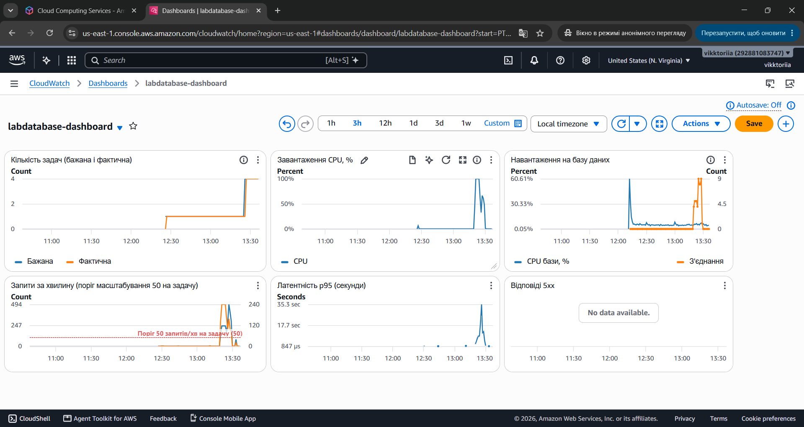
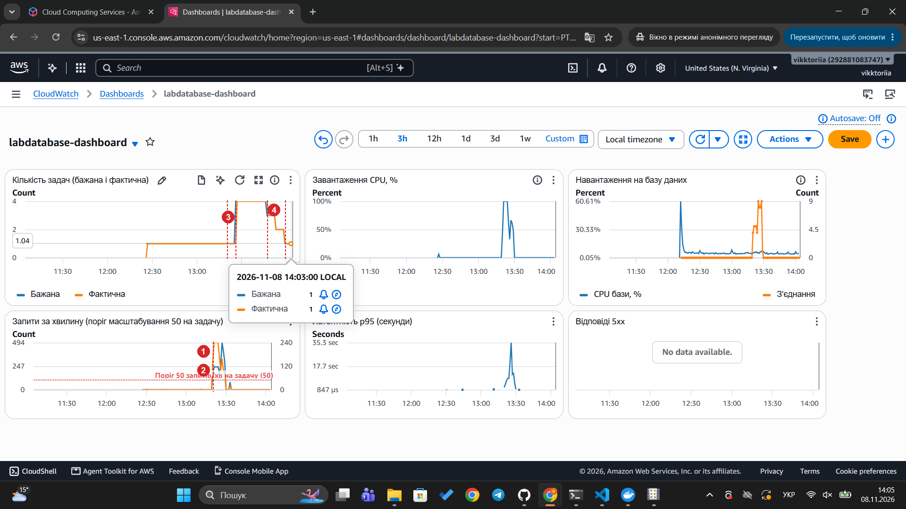

# Автомасштабування

## Параметри політики

| Параметр | Значення | Пояснення |
|---|---|---|
| Мінімум екземплярів | 1 | Сервіс завжди має хоча б один екземпляр |
| Максимум екземплярів | 4 | Верхня межа за умовами лабораторної |
| Метрика | ALBRequestCountPerTarget | Кількість запитів на один екземпляр за хвилину |
| Цільове значення | 50 запитів/хв на екземпляр | Пояснення нижче |
| Cooldown масштабування вгору | 60 с | Пояснення нижче |
| Cooldown масштабування вниз | 300 с | Пояснення нижче |

Політика описана в `terraform/autoscaling.tf` (ресурс `aws_appautoscaling_policy.requests`).

## Чому метрика запитів, а не CPU

Спочатку політика стежила за завантаженням процесора з ціллю 60%. На панелі моніторингу (період 60 с) видно, що CPU кілька разів перетинав цей поріг, але лише короткими сплесками, тоді як більшість часу був близьким до нуля. Водночас латентність p95 залишалась високою (7–15 с) протягом усього навантаження. Це означає, що застосунок здебільшого чекає на відповідь бази даних, а не виконує обчислення, тож завантаження процесора погано відображало навантаження. Кількість запитів на екземпляр краще показує, скільки роботи припадає на кожну задачу, тому політику переведено на неї.

## Обґрунтування цільового значення 50

Поріг 50 запитів на хвилину на один екземпляр обрано з двох міркувань:

- **Запас потужності.** Новий екземпляр запускається приблизно 1–2 хвилини. Якщо чекати, поки навантаження досягне межі, сервіс встигне перевантажитися. Поріг нижчий за межу пропускної здатності дає час на запуск нових задач.
- **Перевірка на тесті.** Під час навантаження з 30 користувачами політика збільшила кількість задач з 1 до 4 (див. історію масштабування нижче).

Значення 50 є стартовим. Якщо під час тесту екземпляри з'являються занадто рано або занадто пізно, його можна змінити в `variables.tf` (`request_target`).

## Період стабілізації (cooldown)

Cooldown — мінімальний час між двома діями масштабування. Політика не додає і не прибирає екземпляри, поки не минув cooldown після попередньої зміни.

- **scale_out_cooldown** (60 с) — пауза після додавання екземпляра. Коротка, бо при зростанні навантаження важливо швидко додати задачі.
- **scale_in_cooldown** (300 с) — пауза після вилучення екземпляра. Довша, бо після падіння навантаження нестача екземплярів одразу дає помилки, а зайвий екземпляр на кілька хвилин коштує мало. Так сервіс не втрачає доступність через короткі паузи в трафіку.

**Що буде, якщо cooldown = 0:** політика реагуватиме на кожне коливання метрики. Екземпляри додаватимуться і вилучатимуться поспіль (flapping), кожен запуск займає час і коштує грошей, а сервіс стає нестабільним.

## Прогін 8 листопада 2026 (основний)

Сценарій із [LOADTEST.md](LOADTEST.md), 30 користувачів, кеш вимкнено. Час — київський (UTC+2).

### Панель моніторингу

Панель `labdatabase-dashboard` описана в `terraform/dashboard.tf`. Графіки:

1. **Кількість задач** — бажана (`DesiredTaskCount`) і фактична (`RunningTaskCount`).
2. **Завантаження CPU** задач застосунку.
3. **Запити за хвилину** — усього і на одну задачу (`RequestCountPerTarget`, саме за нею працює політика) з горизонтальною лінією порогу 50.
4. **Латентність p95** (`TargetResponseTime`).
5. **Відповіді 5xx.** Під час тесту графік порожній («No data available»): балансувальник не надсилає цю метрику, поки немає жодної відповіді 5xx. Тобто помилок сервера не було.
6. **Навантаження на базу** — CPU і кількість з'єднань RDS (додатковий графік для завдання 5).

Знімок під час тесту (13:39). Видно зростання запитів, перетин порогу і появу нових задач:

Знімок після повернення до 1 задачі (14:05) з позначеними моментами. Номери відповідають таблиці нижче, червоні пунктирні лінії — моменти змін:

Той самий знімок без позначок: [dashboard-nocache-full.png](dashboard-nocache-full.png).

### Ключові моменти

| № | Момент | Час | Джерело |
|---|---|---|---|
| 1 | Початок навантаження | 13:20:06 | історія Locust |
| 2 | Перетин порогу: 149 запитів/хв на задачу при цілі 50 | хвилина 13:20 | метрика `RequestCountPerTarget` |
| — | Вихід на стале навантаження (30 користувачів) | 13:23:01 | історія Locust |
| 3 | Рішення про масштабування: бажана кількість 1 → 4 | 13:25:46 | історія масштабування |
| 3 | 4 задачі працюють | 13:26:53 | історія масштабування |
| — | Кінець навантаження | 13:30:06 | історія Locust |
| 4 | Вилучення першої задачі: 4 → 3 | 13:47:01 | історія масштабування |
| — | 3 → 2 | 13:53:01 | історія масштабування |
| — | 2 → 1, повернення до мінімуму | 13:59:01 | історія масштабування |

Від перетину порогу до появи нових задач минуло близько 6 хвилин. Поки працювала одна задача, її CPU був на рівні 100%, і вона обробляла не більше 240 запитів за хвилину.

Перша задача була вилучена через 17 хвилин після кінця навантаження, а до 1 задачі сервіс повернувся через 29 хвилин. Задачі вилучались по одній з інтервалом рівно 6 хвилин.

Політика одразу встановила 4 задачі, а не додавала їх по одній. Target tracking розраховує потрібну кількість пропорційно: 1 задача × 240 / 50 ≈ 4,8, а максимум — 4.

## Прогін 31 жовтня 2026 (попередній)

Історія масштабування з консолі ECS (Service auto scaling → Activity history):

Повна історія за цей день (київський час):

| Час | Дія | Причина |
|---|---|---|
| 20:05 | 3 задачі | навантаження зросло |
| 20:11 | 2 задачі | навантаження впало |
| 20:17 | 1 задача | навантаження впало |
| 20:24 | 3 задачі | наступний тест |
| 20:27 | 4 задачі (максимум) | навантаження зросло |
| 20:48 | 3 задачі | тест завершився |
| 20:54 | 2 задачі | |
| 21:00 | **1 задача** — повернення до мінімуму | |

Після кінця тесту задачі вилучались по одній з інтервалом 6 хвилин. Кількість задач ніколи не перевищила 4 і повернулася до 1 приблизно через 30 хвилин після кінця навантаження.

## Чому екземпляр з'являється не одразу після перетину порогу

Між перетином порогу і появою робочої задачі минає кілька хвилин, бо подія проходить кілька етапів:

1. **Збір метрики.** Балансувальник надсилає `RequestCountPerTarget` у CloudWatch раз на хвилину із затримкою 1–2 хвилини.
2. **Оцінка аларму.** Target tracking створює аларм, який спрацьовує лише після 3 хвилинних точок поспіль вище цілі. Тому одиночний сплеск не додає екземпляр.
3. **Запуск задачі.** ECS змінює бажану кількість, Fargate виділяє ресурси і завантажує образ з ECR. Потім контейнер стартує і виконує `init_db.py`. Це ще 1–2 хвилини.
4. **Перевірка здоров'я.** Балансувальник надсилає трафік на задачу лише після 2 успішних перевірок `/health` з інтервалом 30 с.

## Чому вилучення відбувається значно пізніше за падіння навантаження

- Аларм на зменшення спрацьовує лише після **15 хвилинних точок поспіль** нижче цілі. Так AWS налаштовує target tracking, щоб не вилучати задачі через коротку паузу в трафіку.
- Після кожного вилучення діє **scale_in_cooldown = 300 с**, тому задачі вилучаються по одній з паузами.
- Задача зупиняється не миттєво. Спершу балансувальник перестає надсилати їй нові запити і чекає завершення поточних (`deregistration_delay = 30` с). Потім ECS надсилає контейнеру SIGTERM, і gunicorn дообробляє запити, що лишилися. Щоб сигнал доходив до gunicorn, у `Dockerfile` він запускається через `exec`.

Тому від кінця навантаження до повернення до 1 задачі може минути 15–30 хвилин.
