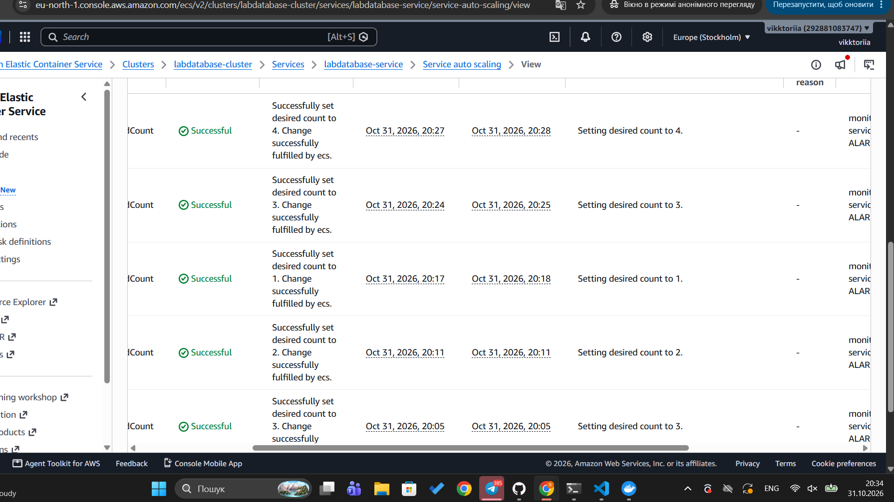

# Автомасштабування

## Параметри політики

| Параметр | Значення | Пояснення |
|---|---|---|
| Мінімум екземплярів | 1 | Сервіс завжди має хоча б один екземпляр |
| Максимум екземплярів | 4 | Верхня межа за умовами лабораторної |
| Метрика | ALBRequestCountPerTarget | Кількість запитів на один екземпляр за хвилину |
| Цільове значення | 50 запитів/хв на екземпляр | Пояснення нижче |
| Cooldown масштабування вгору | 60 с | Пояснення нижче |
| Cooldown масштабування вниз | 300 с | Пояснення нижче |

Політика описана в `terraform/autoscaling.tf` (ресурс `aws_appautoscaling_policy.requests`).

## Чому метрика запитів, а не CPU

Спочатку політика стежила за завантаженням процесора з ціллю 60%. На панелі моніторингу (період 60 с) видно, що CPU кілька разів перетинав цей поріг, але лише короткими сплесками, тоді як більшість часу був близьким до нуля. Водночас латентність p95 залишалась високою (7–15 с) протягом усього навантаження. Це означає, що застосунок здебільшого чекає на відповідь бази даних, а не виконує обчислення, тож завантаження процесора погано відображало навантаження. Кількість запитів на екземпляр краще показує, скільки роботи припадає на кожну задачу, тому політику переведено на неї.

## Обґрунтування цільового значення 50

Поріг 50 запитів на хвилину на один екземпляр обрано з двох міркувань:

- **Запас потужності.** Новий екземпляр запускається приблизно 1–2 хвилини. Якщо чекати, поки навантаження досягне межі, сервіс встигне перевантажитися. Поріг нижчий за межу пропускної здатності дає час на запуск нових задач.
- **Перевірка на тесті.** Під час навантаження з 30 користувачами політика збільшила кількість задач з 1 до 4, а після закінчення навантаження поступово повернула їх до 1. Це видно в історії масштабування (Activity history).

Значення 50 є стартовим. Якщо під час тесту екземпляри з'являються занадто рано або занадто пізно, його можна змінити в `variables.tf` (`request_target`).

## Період стабілізації (cooldown)

Cooldown — мінімальний час між двома діями масштабування. Політика не додає і не прибирає екземпляри, поки не минув cooldown після попередньої зміни.

- **scale_out_cooldown** (60 с) — пауза після додавання екземпляра. Коротка, бо при зростанні навантаження важливо швидко додати задачі.
- **scale_in_cooldown** (300 с) — пауза після вилучення екземпляра. Довша, бо після падіння навантаження нестача екземплярів одразу дає помилки, а зайвий екземпляр на кілька хвилин коштує мало. Так сервіс не втрачає доступність через короткі паузи в трафіку.

**Що буде, якщо cooldown = 0:** політика реагуватиме на кожне коливання метрики. Екземпляри додаватимуться і вилучатимуться поспіль (flapping), кожен запуск займає час і коштує грошей, а сервіс стає нестабільним.

## Результат тесту

З історії масштабування видно покрокову зміну кількості задач:

| Час (UTC+2) | Дія |
|---|---|
| 20:05 | 3 задачі (навантаження зросло) |
| 20:11 | 2 задачі |
| 20:17 | 1 задача |
| 20:24 | 3 задачі (навантаження знову зросло) |
| 20:27 | 4 задачі (максимум) |

Вилучення відбувалось з інтервалом приблизно 6 хвилин, що відповідає cooldown 300 с. Кількість задач ніколи не перевищила 4.