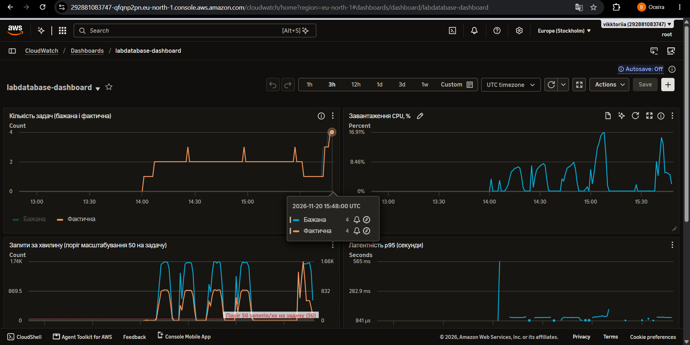

# Автомасштабування

## Параметри політики

Масштабування налаштоване в `terraform/autoscaling.tf` через **step scaling** і два аларми CloudWatch.

| Параметр | Значення | Пояснення |
|---|---|---|
| Мінімум / максимум задач | 1 / 4 | Верхня межа за умовами лабораторної; мінімум далі змінює розклад (див. [SCHEDULE.md](SCHEDULE.md)) |
| Метрика | `RequestCountPerTarget` (Sum за 60 с) | Кількість запитів за хвилину на одну задачу |
| Поріг збільшення | 300 запитів/хв на задачу | Пояснення нижче |
| Аларм збільшення | 1 хвилинна точка вище порогу | Реакція без очікування кількох точок поспіль |
| Кроки збільшення | перевищення до 2×: +1 задача; понад 2×: +2 | |
| Cooldown збільшення | 60 с | |
| Аларм зменшення | 10 хвилинних точок поспіль нижче 150 запитів/хв | Зменшення навмисно повільне |
| Крок зменшення | −1 задача | |
| Cooldown зменшення | 300 с | |

## Чому step scaling, а не target tracking

Спочатку використовувалась політика target tracking (ціль 50 запитів/хв на задачу). AWS сам створює для неї аларми, і аларм на збільшення чекає **три хвилинні точки поспіль** над порогом, а на зменшення — п'ятнадцять. Через це нові задачі з'явились лише через 5 хв 46 с після початку навантаження (тест 8 листопада), коли тест уже майже закінчився.

Step scaling використовує власний аларм, де достатньо однієї хвилинної точки. Крім того, політика більше не залежить від старої цілі 50, яка після виправлення продуктивності (див. [LOADTEST.md](LOADTEST.md)) стала надто низькою: один екземпляр без проблем обробляє понад 500 запитів за хвилину.

## Обґрунтування порогу 300

Прогони з 2 задачами при 21 запиті/с (≈ 630 запитів/хв на задачу) мали p95 ≈ 75–96 мс і CPU задачі менше 10%. Поріг 300 запитів/хв на задачу (5 запитів/с) обраний із запасом: задачі додаються задовго до насичення, а новий екземпляр запускається приблизно хвилину. Поріг зменшення (150) вдвічі нижчий, щоб між зростанням і спадом була зона без дій і не виникало постійного додавання та видалення задач.

## Cooldown

Cooldown — мінімальний час між двома діями масштабування.

- **Збільшення (60 с)** — коротка пауза: при зростанні навантаження важливо швидко додати задачі.
- **Зменшення (300 с)** — довша: нестача екземплярів одразу дає помилки, а зайвий екземпляр на кілька хвилин коштує мало.

**Що буде, якщо cooldown = 0:** політика реагуватиме на кожне коливання метрики, екземпляри додаватимуться й видалятимуться поспіль (flapping), кожен запуск займає час і коштує грошей.

## Результат тесту

Тест 20 листопада 2026, старт 17:39:12 (київський час), 30 користувачів, кеш увімкнено, 1 задача на старті.

*Примітка до скріншота: на графіку «Запити за хвилину» червона лінія порогу підписана «50 запитів/хв на задачу». Це підпис зі старої політики target tracking, який дашборд ще показував під час тесту. Діючий поріг step scaling у цьому тесті — **300 запитів/хв на задачу**; саме він запустив масштабування (значення 1370 запитів за хвилину в точці 17:39 перевищило його).*

| Подія | Час | Від старту |
|---|---|---|
| Початок навантаження | 17:39:12 | 0 |
| Аларм `scale-out` у стані ALARM | 17:42:51 | +3 хв 39 с |
| Бажана кількість задач 1 → 3 | 17:42:51 | +3 хв 39 с |
| Дві нові задачі зареєстровані в балансувальнику | 17:43:28 | +4 хв 16 с |
| Бажана кількість 3 → 4 (максимум) | 17:45:51 | +6 хв 39 с |
| Четверта задача працює | 17:46:52 | +7 хв 40 с |

Під час наростання й масштабування помилок не було (0 з 12 408 запитів), p95 лишався 82 мс.

Порівняно з 8 листопада (нові задачі через 5 хв 46 с) нові задачі з'явились на ≈ 1,5 хв швидше. Вилучення задач відбувається за правилом: 10 хвилин поспіль нижче порогу, потім по одній з паузою 300 с.

## Чому задача все одно з'являється не одразу

У журналі аларму видно, що значення 1370 запитів за хвилину в точці 17:39 перевищувало поріг, але аларм побачив цю точку лише о 17:42:51. Налаштування аларму правильне (1 період по 60 с); затримку створює сама метрика: **метрики балансувальника потрапляють у CloudWatch із запізненням ≈ 2–3 хвилини**. Крім того:

- аларм виконується раз на хвилину;
- нова задача запускається і проходить перевірку здоров'я ≈ 30–60 с (`health_check_grace_period_seconds = 180`).

Швидше реагувати можна лише за метрикою, яка надходить без такої затримки (наприклад, CPU задач), але вона погано відображає навантаження цього застосунку: CPU лишається нижче 20% навіть при 30 користувачах.

## Чому вилучення відбувається значно пізніше за падіння навантаження

- Аларм на зменшення спрацьовує лише після 10 хвилин поспіль нижче 150 запитів/хв на задачу, щоб не вилучати задачі через коротку паузу в трафіку.
- Після кожного вилучення діє cooldown 300 с, тому задачі вилучаються по одній.
- Задача зупиняється не миттєво: балансувальник перестає надсилати їй нові запити й чекає завершення поточних (`deregistration_delay = 30` с), потім ECS надсилає SIGTERM. Щоб сигнал доходив до gunicorn, у `Dockerfile` він запускається через `exec`.
