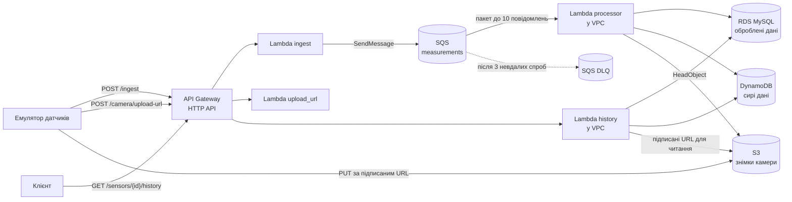

# Архітектура

## Схема конвеєра

Усі приймання, обробка і читання виконуються Lambda-функціями, що запускаються подіями (HTTP-запит або повідомлення в черзі). Постійно запущених серверів і контейнерів немає.

## Компоненти

| Компонент | Призначення | Файли |
|---|---|---|
| **Емулятор** | Єдиний звичайний процес: імітує чотири датчики, шле вимірювання через HTTP | `emulator/` |
| **API Gateway (HTTP API)** | Публічна точка входу: маршрутизація, обмеження частоти запитів (300/с, сплеск 600), TLS | `terraform/apigw.tf` |
| **Lambda `ingest`** | Перевіряє `x-api-key` і поля, видає `message_id`, кладе повідомлення в чергу, відповідає `202`/`400`/`401`. Нічого не обробляє | `functions/ingest/` |
| **SQS `measurements`** | Буфер між приймачем і обробником: гарантує збереження повідомлень і згладжує піки | `terraform/sqs.tf` |
| **SQS DLQ** | Повідомлення, які не вдалося обробити за 3 спроби | `terraform/sqs.tf` |
| **Lambda `processor`** | Тригер від черги (пакет до 10): нормалізація одиниць, діапазон, відхилення, аномалії; ідемпотентний запис у MySQL і DynamoDB | `functions/processor/` |
| **RDS MySQL** | Оброблені вимірювання (таблиця `measurements`), запити за датчиком і часом | `terraform/rds.tf` |
| **DynamoDB** | Сирі вимірювання: ключ розділу `sensor_id`, ключ сортування `measured_at` (бонус) | `terraform/dynamodb.tf` |
| **Lambda `history`** | `GET /sensors/{id}/history` (SQL або DynamoDB), `GET /stats` | `functions/history/` |
| **Lambda `upload_url`** | Видає одноразовий підписаний URL для завантаження знімка (бонус) | `functions/upload_url/` |
| **S3** | Знімки камери, приватне сховище, доступ лише за підписаним URL або через IAM | `terraform/s3.tf` |
| **VPC** | Приватна мережа для бази й двох функцій, що до неї звертаються; доступ до DynamoDB і S3 через безкоштовні gateway endpoints, без NAT | `terraform/network.tf` |
| **IAM** | Окрема роль на кожну функцію з мінімально потрібними правами | `terraform/iam.tf` |

## Мережа

База й функції `processor` і `history` розташовані в приватних підмережах без виходу в інтернет. Функції `ingest` і `upload_url` працюють поза VPC, бо до бази не звертаються. Чому з'єднання з базою обмежують і як функції до неї підключаються — у [DATA.md](DATA.md).

Тригер SQS → Lambda виконує керований сервіс AWS, тому для читання з черги функції у VPC доступ до інтернету не потрібен.

## Потік одного вимірювання

1. Емулятор шле `POST /ingest` з JSON і заголовком `x-api-key`.
2. API Gateway викликає `ingest`; та валідує дані, додає `message_id` (UUID) і `received_at`, кладе в SQS, повертає `202` з `message_id`.
3. SQS зберігає повідомлення; Lambda event source mapping збирає до 10 повідомлень (не довше 1 с) і викликає `processor`.
4. `processor` для кожного повідомлення: бере попереднє значення датчика, обчислює нормалізоване значення, відхилення й ознаку аномалії, робить `INSERT IGNORE` у MySQL (ключ ідемпотентності — `message_id`), записує сирий елемент у DynamoDB.
5. Невдалі повідомлення повертаються у чергу і після 3 спроб потрапляють у DLQ; успішні з пакета видаляються.
6. `GET /sensors/{id}/history` читає з MySQL (або DynamoDB за `source=nosql`) і повертає масив у зворотному хронологічному порядку.

## Безпека

- Приймач і читання історії вимагають заголовок `x-api-key`. Ключ генерує Terraform, порівняння виконується за сталий час.
- Секрети (пароль бази, ключ) не зберігаються в репозиторії: вони в локальному стані Terraform і в змінних середовища функцій. Для більшого захисту їх можна перенести в AWS Secrets Manager.
- База недоступна ззовні (`publicly_accessible = false`), правило групи безпеки пускає лише функції.
- Бакет S3 повністю закритий (`block_public_access`), знімки віддаються за підписаними URL на 15 хвилин.
