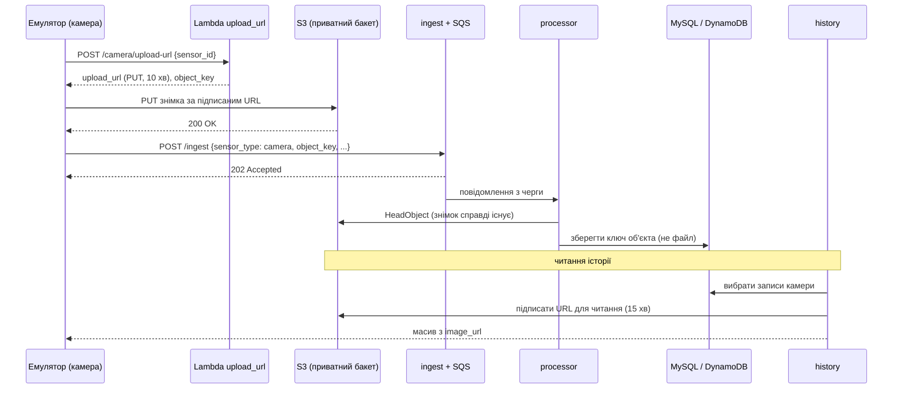

# Бінарні дані в об'єктному сховищі (камера)

Четвертий датчик — камера `cam-01`. Раз на 10-30 с (за замовчуванням 15 с) вона надсилає знімок розміром до 1 МБ. Знімок **не проходить ні через чергу, ні через базу**: він завантажується прямо в S3 за одноразовим підписаним URL, а в чергу йде звичайне повідомлення з ключем об'єкта.

## Послідовність дій



Кроки в коді:

1. `emulator/emulator.py`, `CameraThread.upload_image()`: запит URL, потім `PUT` знімка (PNG ≈ 100-250 КБ, не більше 1 МБ) із заголовком `content-type: image/png`.
2. `functions/upload_url/handler.py`: генерує ключ `camera/<sensor_id>/<uuid>.png` і підписаний URL для `PutObject` на 600 с. Підпис створюється локально, функція не звертається до S3.
3. Після успішного завантаження емулятор шле `POST /ingest` з `sensor_type: "camera"`, `value` — розмір у байтах, `unit: "bytes"` і `object_key`. Приймач вимагає, щоб ключ починався з `camera/<sensor_id>/`.
4. `functions/processor/handler.py` перевіряє `HeadObject` (знімок існує) і зберігає ключ у стовпці `object_key` та в DynamoDB.
5. `functions/history/handler.py` для записів із `object_key` додає поле `image_url`: підписаний URL на читання з терміном дії 900 с.

## Приклад

```powershell
curl -s -H "x-api-key: $API_KEY" "$API_URL/sensors/cam-01/history?limit=1"
```

```json
[
  {
    "sensor_id": "cam-01",
    "sensor_type": "camera",
    "value": 183204.0,
    "unit": "bytes",
    "measured_at": "2026-11-21T18:00:15.201Z",
    "object_key": "camera/cam-01/3f0a1d3e-4b8c-4f0e-9c1a-7c2d5e6f8a90.png",
    "image_url": "https://iot-lab3-images-xxxx.s3.eu-north-1.amazonaws.com/camera/cam-01/...?X-Amz-Expires=900&X-Amz-Signature=..."
  }
]
```

(Фрагмент ілюстративний, поля скорочено.) Посилання з `image_url` відкривається в браузері протягом 15 хвилин, потім S3 відповідає `403`. Без підпису прямий доступ до об'єкта теж закритий.

## Чому бінарні дані не передають через чергу і не зберігають у базі

**Не через чергу:**
- Повідомлення SQS обмежене **256 КБ**, а знімок може бути до 1 МБ. Для великих файлів черга просто не підходить.
- Навіть малий файл збільшує вартість і час: кожен байт проходить через API Gateway, Lambda (платиться за час виконання і пам'ять) і чергу, а потім ще раз читається обробником.
- Тіло запиту до API Gateway і Lambda обмежене (до 10 МБ і 6 МБ відповідно), а передача через функцію витрачає її час на копіювання байтів.

**Не в базі:**
- Файли різко збільшують розмір таблиці, бекапів і реплікації; запити з великими `BLOB` повільні, а індекси й кеш бази захаращуються.
- Реляційна база оптимізована для структурованих даних, а не для зберігання файлів. Об'єктне сховище має практично необмежену ємність і коштує в рази дешевше за диск бази.
- З'єднання з базою обмежене ([DATA.md](DATA.md)), а завантаження великих об'єктів утримувало б його довго.
- Віддача зображень з бази змушує функцію читати їх і пересилати; з S3 клієнт завантажує файл безпосередньо.

У базі лишається лише **ключ** — короткий текстовий вказівник на об'єкт.

## Що таке підписаний URL

Підписаний URL (presigned URL) — це звичайне посилання на об'єкт S3, до якого додано **криптографічний підпис**, термін дії та параметри дозволеної операції. Підпис створює той, хто має права на сховище (тут — Lambda з її роллю IAM), і той, хто має це посилання, може виконати саме цю одну дію (`PUT` або `GET` цього об'єкта) без власних ключів AWS і без доступу до решти бакета.

Властивості:
- **обмежений час:** 10 хвилин для завантаження, 15 хвилин для читання; після цього S3 відповідає `403`;
- **обмежена дія й об'єкт:** посилання на `PUT` не дає читати, а посилання на один ключ не відкриває інші;
- **не потрібні секрети в клієнті:** емулятор не знає ключів AWS, лише отримує посилання від API;
- **права обмежені роллю:** функція `upload_url` має право лише `s3:PutObject` на `camera/*`, а `history` лише `s3:GetObject`; підписаний URL не може дати більше.

Бакет повністю закритий (`block_public_access`), тож доступ до знімків можливий тільки так.
