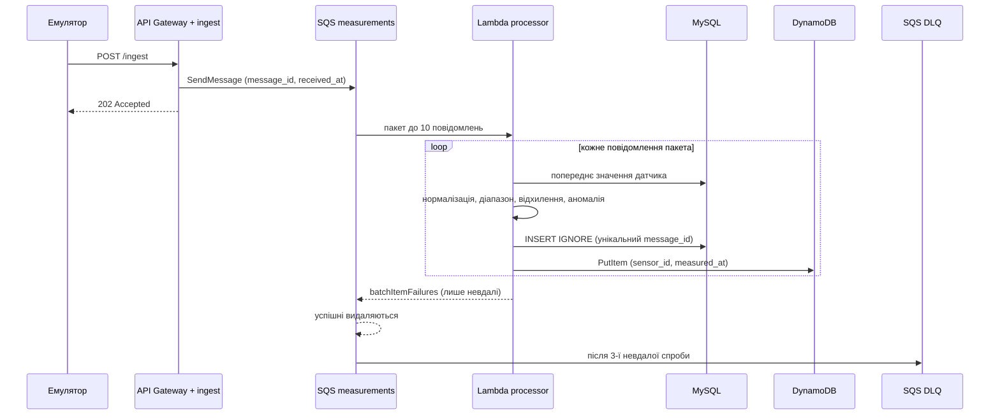

# Обробка даних функціями

## Потік даних

## Вибраний дизайн: одна функція-диспетчер

Обробку виконує одна функція `processor`, яка за `sensor_type` викликає потрібну логіку (`functions/processor/logic.py`). Окрема функція на кожен тип не потрібна з таких причин:

| Аргумент | Диспетчер (вибрано) | Функція на кожен тип |
|---|---|---|
| Інфраструктура | одна черга, одна DLQ, один тригер | три черги (або SNS-тема з фільтрами), три DLQ, три тригери |
| Спільні кроки | перевірка, ідемпотентність, запис у обидві бази пишуться один раз | дублюються або виносяться в спільний шар |
| Різниця між типами | невелика: лише одиниці, діапазон і поріг стрибка (таблиця нижче) | була б виправдана складною, різнорідною логікою |
| Масштабування | один пул паралельності (до 5) для всіх типів | незалежне масштабування за типом |
| Ізоляція збоїв | помилка в одному типі повторює лише це повідомлення, не зупиняючи пакет | збій повністю ізольований за типом |
| З'єднання з базою | одне на екземпляр, загалом ≤ 5 | у сумі більше з'єднань, бо більше пулів |

Недолік диспетчера: усі типи ділять один пул паралельності, тож «галасливий» датчик може затримати інші, а зміна коду одного типу означає розгортання всієї функції. Для трьох типів з однаковою схемою даних це прийнятна ціна. Якби типи вимагали різної обробки або різного навантаження, слід було б перейти до окремих черг.

## Що робить обробка

Для кожного типу виконується нормалізація, перевірка діапазону і порівняння з попереднім вимірюванням цього датчика (`delta`).

| Тип | Одиниці на вході → нормалізована | Допустимий діапазон | Аномалія «стрибок» |
|---|---|---|---|
| `temperature` | `C`, `F`, `K` → `C` | -50...60 °C | зміна більша за 5 °C |
| `humidity` | `%` | 0...100 % | зміна більша за 20 п.п. |
| `light` | `lux`, `klx` → `lux` | 0...120 000 lux | зміна більша за 50 000 lux |
| `camera` | `bytes` | числової обробки немає | перевіряється, що знімок є в S3 (`HeadObject`) |

- Значення за межами діапазону позначається аномалією `out_of_range`, різкий стрибок — `spike`. Аномальне вимірювання **зберігається**, але з `is_anomaly = 1` і причиною: це дані, які можуть мати цінність для аналізу.
- Невідомий тип або одиниця виміру (наприклад, `humidity` у `lux`) — це помилка: повідомлення піде на повторну обробку і, зрештою, в DLQ.
- Поле `delta` береться відносно останнього збереженого вимірювання з меншим `measured_at`, тож порядок надходження повідомлень не впливає на результат.

## Ідемпотентність

Черга SQS гарантує доставку «щонайменше один раз»: те саме повідомлення може прийти двічі (збій функції після запису, таймаут видимості, повторна доставка). Дубль у базі неприпустимий, тому:

- Приймач присвоює кожному повідомленню `message_id` (UUID v4), і він потрапляє в тіло повідомлення.
- У таблиці `measurements` стовпець `message_id` має **унікальний індекс** (`uq_message_id`).
- Запис виконується як `INSERT IGNORE`: при повторі рядок не додається (`rowcount = 0`), помилки немає, функція позначає повідомлення як оброблене (`status: duplicate` у журналі).
- У DynamoDB природний ключ `(sensor_id, measured_at)`: повторний `PutItem` перезаписує той самий елемент тими самими значеннями.

Перевірено юніт-тестом `test_processor_is_idempotent_and_reports_failures`: те саме повідомлення, надіслане двічі в одному пакеті, дає один рядок у базі.

## Що відбувається з повідомленням, яке не вдалося обробити

1. Функція перехоплює помилку **окремо для кожного повідомлення** і повертає `batchItemFailures` (режим `ReportBatchItemFailures`). Решта пакета вважається обробленою й видаляється з черги, тож один «поганий» запис не блокує десять сусідніх.
2. Невдале повідомлення лишається в черзі й стає видимим знову після `visibility_timeout` (90 с).
3. Після **3 невдалих отримань** (`maxReceiveCount = 3`) SQS автоматично переміщує його в чергу недоставлених `iot-lab3-measurements-dlq`, де воно зберігається 14 днів.
4. Причина збою (клас і текст помилки, `receive_count`) пишеться в журнал функції у форматі JSON.

Докладніше про DLQ і демонстрацію: [DLQ.md](DLQ.md).

## Обмеження паралельності

`maximum_concurrency = 5` у event source mapping обмежує кількість одночасних екземплярів обробника, а отже і кількість з'єднань до бази ([DATA.md](DATA.md)). Орієнтовно пакет з 10 повідомлень обробляється за 100-200 мс на екземпляр (точний час — поле `Duration` у журналі функції), тож 5 екземплярів із запасом перекривають навантаження емулятора (≈ 45 повідомлень/с).
